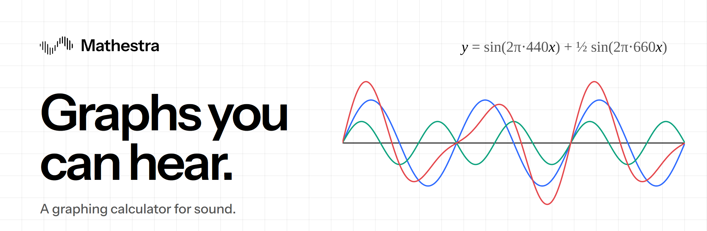
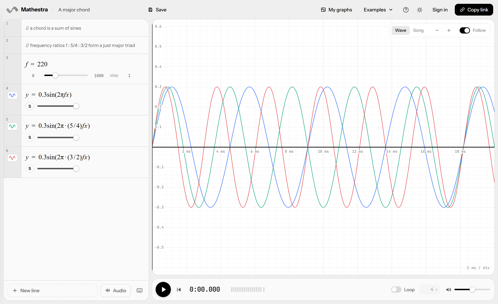
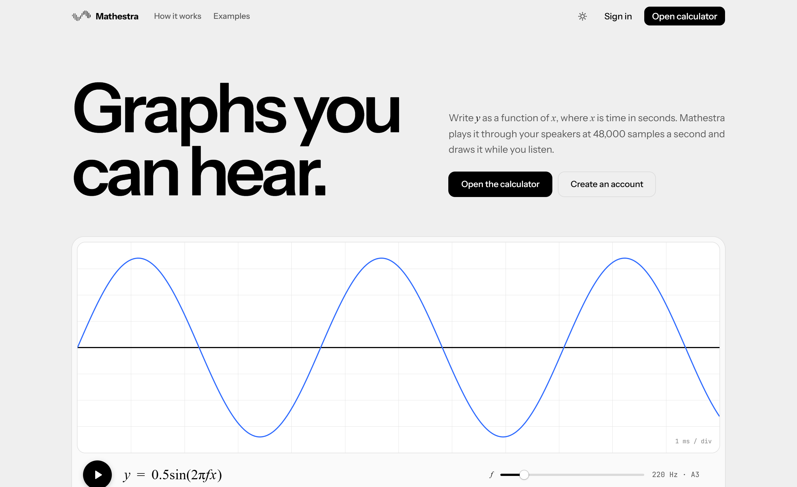
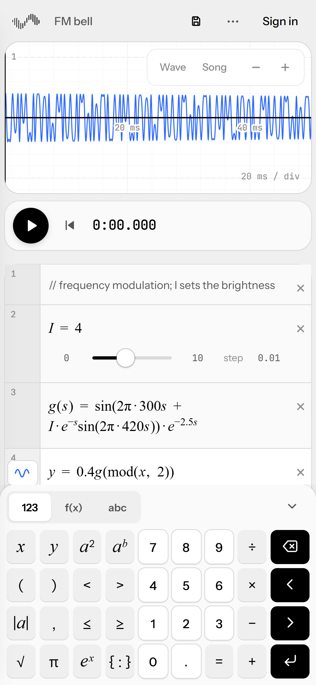

<div align="center">

<a href="https://mathestra.space">
  <picture>
    <source media="(prefers-color-scheme: dark)" srcset=".github/assets/banner-dark.png" />
    
  </picture>
</a>

<br />
<br />

**Write an equation. Hear it. Watch it move.**

Mathestra is a graphing calculator for sound. `y` is the speaker, `x` is time,
and every graph is the exact waveform that comes out of your speakers.

<br />

<a href="https://mathestra.space"></a>

<br />
<br />


<a href="LICENSE"></a>

</div>

<br />

<picture>
  <source media="(prefers-color-scheme: dark)" srcset=".github/assets/app-dark.png" />
  
</picture>

<p align="center"><sub>Three sines, one chord. Each <code>y = …</code> line is a track you can see and hear.</sub></p>

## The idea

```
y = sin(2π·440x)
```

That line is concert A. `x` is time in seconds, `y` is where the speaker cone sits, from −1 to 1,
and Mathestra plays it at 48,000 samples a second while drawing it in real time. No synthesiser
presets, no hidden mapping from shapes to notes: the sound **is** the graph.

From there it is just maths. Add sines and you get chords. Multiply by `e^{-8x}` and a note decays
into a pluck. Put `mod(x, 0.5)` inside a function and you have a drum loop. Drag a slider and hear
the change before you let go.

## Features

<table>
<tr>
<td width="50%" valign="top">

**🎛 Equations you can hear**<br />
Sliders, lists, piecewise expressions and functions of your own, typeset like Desmos as you type.

**🎚 Tracks**<br />
Every `y = …` line is a track with its own colour, volume, solo and visibility.

**🎧 Audio clips**<br />
Drop in a recording and use it as a function of time, like `y = 0.5drums(2x)`.

**⌨️ Math keypad**<br />
On phones and tablets it replaces the system keyboard, so `√`, `π` and `{ : }` are one tap away.

</td>
<td width="50%" valign="top">

**🔗 Links that are the piece**<br />
The whole graph is compressed into the link. Anyone can play it; only its owner can edit it, and
everyone else gets a **Make a copy** button.

**☁️ My graphs**<br />
Sign in with Google or email (verified with a 6-digit code) to keep your work in the cloud.

**🌗 Light and dark**<br />
A monochrome interface where only the waveforms carry colour.

**📱 Everywhere**<br />
Responsive from small phones to wide monitors, with the keyboard and keypad handled properly.

</td>
</tr>
</table>

<table>
<tr>
<td width="62%">
<picture>
  <source media="(prefers-color-scheme: dark)" srcset=".github/assets/landing-dark.png" />
  
</picture>
</td>
<td width="38%">
<picture>
  <source media="(prefers-color-scheme: dark)" srcset=".github/assets/phone-dark.png" />
  
</picture>
</td>
</tr>
</table>

## Quick start

Requires Node 18 or later.

```sh
git clone <this repo>
cd mathestra
npm install
npm run dev      # http://localhost:5173
```

| Command | What it does |
|---|---|
| `npm run dev` | dev server with hot reload |
| `npm test` | compiler, sharing, audio, password and preset tests |
| `npm run build` | type-checks, then builds a static site into `dist/` |
| `npm run preview` | serves the production build locally |

The calculator works with no setup at all. Accounts and saved graphs need Supabase (below).

## The language

| You write | Meaning |
|---|---|
| `y = 0.5sin(2π·440x)` | a track (a 440 Hz sine at half volume) |
| `f = 440` | a slider |
| `b = 60/B` | a computed constant |
| `k(s) = sin(2π·50s)·e^{-8s}` | a function of your own |
| `{x<1: a, x<2: b, c}` | piecewise; `{0<x<2}` is 1 there and silent otherwise |
| `N = [0, 4, 7]`, `N[2]`, `length(N)` | lists (1-based, index is floored) |
| `a_1`, `H_lead` | subscripted names count as one variable |
| `// text` | a note |

Multiplication can be implied, as in Desmos: `2πfx`, `3(x+1)`, `sin 2x`.
Unicode `π τ · × − ≤ ≥ √ ²` is accepted.

<details>
<summary><b>Functions and constants</b></summary>

<br />

`sin cos tan sec csc cot arcsin arccos arctan sinh cosh tanh sqrt cbrt exp ln log abs sign floor ceil round mod min max length total mean`

Constants: `pi`, `tau`, `e`. Imported audio clips become functions too, named after the file.

</details>

<details>
<summary><b>Controls</b></summary>

<br />

| | |
|---|---|
| **Graph icon** | click to hide or show a track (hidden tracks are silent); hold or right-click for colour, opacity, thickness and line style |
| **S** | solo a track; the slider next to it sets its volume |
| **Screen** | drag to pan, scroll to zoom time, Shift+scroll to zoom height, click to move the playhead |
| **Wave / Song** | 20 ms of detail, or 4 s of the whole piece |
| **Space** | play and pause |
| **Enter / Backspace** | add a line; remove an empty one |
| **Ctrl+S, Ctrl+Z, Ctrl+Y** | save, undo, redo |

Output is clipped at ±1, drawn as dashed lines on the screen; the last segment of the level meter
lights when it happens.

</details>

## How it works

```
 your equations ──▶ lexer ──▶ parser ──▶ compiler ──▶ JavaScript
                                                         │
                         ┌───────────────────────────────┴──────────────┐
                         ▼                                              ▼
          AudioWorklet (once per sample, 48 kHz)       canvas graph (once per pixel)
                         │                                              │
                         ▼                                              ▼
                     speakers                                        screen
```

The same compiled function feeds both the speakers and the screen, which is why what you see is
exactly what you hear.

| Where | What |
|---|---|
| `src/math/` | lexer, parser and compiler. Errors are per line, so a typo never silences the other tracks |
| `public/mathestra-processor.js` | the AudioWorklet: runs every track once per sample, with click-free gain smoothing and looping |
| `src/audio/` | the audio engine and imported clips (decoded in the browser, kept in IndexedDB, uploaded when signed in) |
| `src/ui/graph.ts` | canvas plotting at device-pixel resolution; dense audio becomes a min/max envelope per pixel column |
| `src/ui/mathField.ts`, `panel.ts`, `keypad.ts` | the typeset editor, the expression list and the keypad |
| `src/state.ts` | the document model and link sharing (JSON, deflate, base64url) |
| `src/lib/supabase.ts` | sign-in, email codes and saved graphs |

**Ownership without accounts in the link.** Each graph carries an owner stamp: a random key for the
browser that made it, plus a one-way hash of the owner's account. Links never reveal who made
them, but the owner can still edit on any of their devices.

**Pieces too big for a link.** Short links such as `/app/?p=name` open a piece stored as
`public/p/name.txt`. They always open view-only.

## Pages

| Path | Source |
|---|---|
| `/` | landing page (`index.html`, `src/landing/`) |
| `/app/` | the calculator (`app/index.html`, `src/main.ts`) |
| `/privacy/`, `/terms/` | legal pages (`privacy/`, `terms/`, `src/legal/`) |
| anything else | `404.html` |

## Accounts and saved graphs

<details>
<summary><b>Setting up Supabase</b></summary>

<br />

1. Copy `.env.example` to `.env.local` and fill in your project's **public** settings:
   ```
   VITE_SUPABASE_URL=https://<project>.supabase.co
   VITE_SUPABASE_PUBLISHABLE_KEY=sb_publishable_...
   ```
   Never put the Supabase *secret* key or the Google *client secret* in the site. The Google
   secret belongs only in Supabase, under Authentication, Providers, Google.
2. **SQL Editor:** run `supabase/schema.sql` (the `graphs` table; row level security limits
   every user to their own graphs), then `supabase/storage.sql` (the `audio` bucket for clips).
   On a database created before the 5 MB limit, also run `supabase/raise-graph-limit.sql`.
3. **Authentication, URL Configuration:** add `http://localhost:5173/app/` and your production
   `https://<domain>/app/` to **Redirect URLs**.
4. **Authentication, Emails:** paste `supabase/email-templates/confirm-signup.html` into
   "Confirm signup" and `reset-password.html` into "Reset password" (the subject is in the
   comment at the top of each file). Keep "Email OTP length" at 6 and "Confirm email" on.
   For real traffic, set up custom SMTP: Supabase's built-in sender allows only a few emails an
   hour.

When deploying, set the same two `VITE_` variables in your host's environment settings.

</details>

## License

[MIT](LICENSE). Use it, fork it, build on it; just keep the copyright notice.

<br />

<div align="center">

<a href="https://mathestra.space">
  <picture>
    <source media="(prefers-color-scheme: dark)" srcset="public/brand/logo-white.svg" />
    
  </picture>
</a>

<sub><a href="https://mathestra.space">Live</a> · <a href="https://mathestra.space/privacy/">Privacy</a> · <a href="https://mathestra.space/terms/">Terms</a></sub>

</div>
